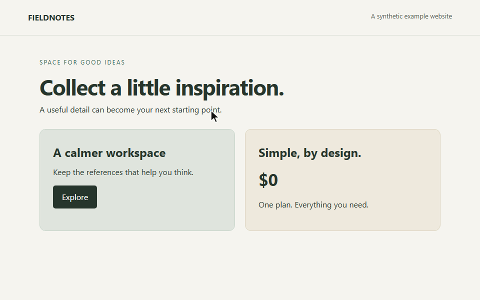
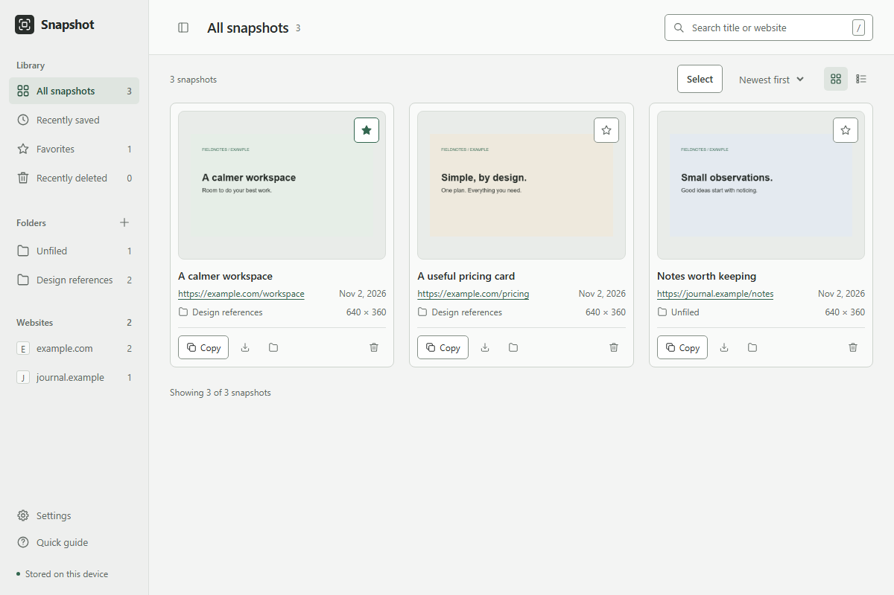
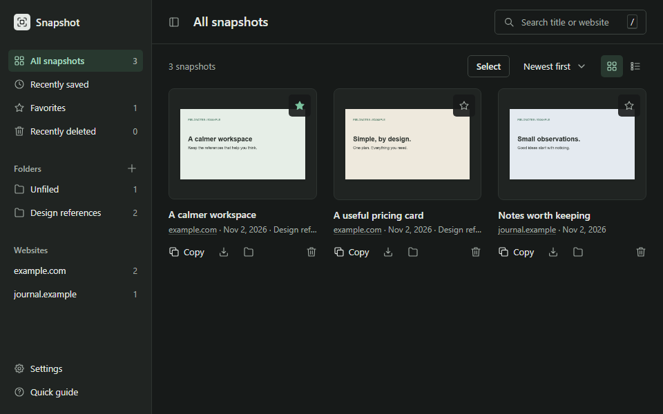
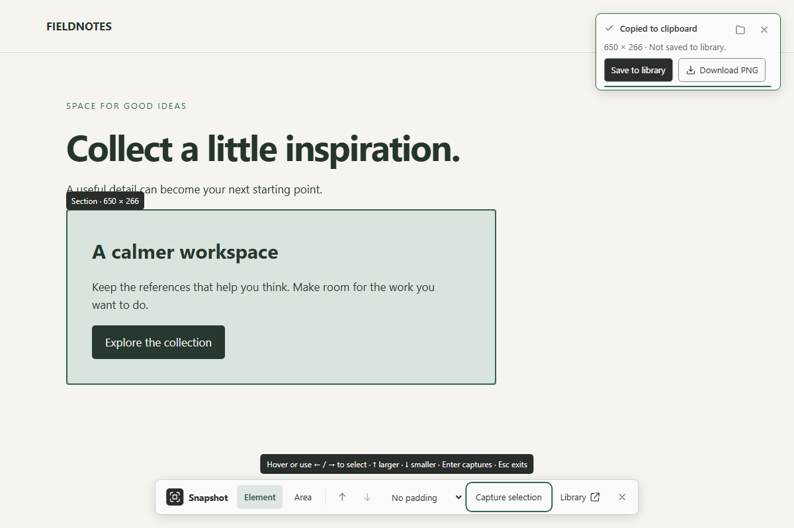

# Snapshot

**Click an element on a webpage to copy it as an image.**

Snapshot is a small Chrome extension for capturing parts of a page, like a chart, a code block or a pricing card. Hover over what you want and click, or drag to select an area. Captures go to your clipboard, and you can save the ones you want to keep. No account needed; nothing is uploaded.



### [⬇ Download Snapshot 1.0.0 (ZIP)](https://github.com/CoffeeRunsMyCode/snapshot-extension/releases/latest)

Free and open source (MIT) · Chrome 116 or newer · installs in about a minute with Chrome's **Load unpacked** ([steps](#install-about-a-minute))

## What it does

- **Capture an element or an area.** Hover to see an outline, then click to capture that element. Drag a rectangle if you need a different selection.
- **Copy, save or download.** Paste a capture into a message, doc or issue. You can also save it to the library or download a PNG.
- **Keep a local library.** Organize saved captures with folders and favorites, search by name or source, and download several as a ZIP. Saved captures can include the page title and link for reference.
- **Access only when you use it.** Snapshot gets access to the current tab when you start a capture. It doesn't request access to every website you visit. There are no accounts, uploads or analytics.
- **Use the keyboard.** Alt+Shift+S starts capture, arrow keys select an element, and Alt+Shift+L opens the library. Light and dark themes are available too.

Your usual screenshot tool works well for selecting a rectangle. Snapshot is handy when you want a particular page element without lining up the edges yourself. Chrome DevTools can capture individual elements too; Snapshot puts that selection directly on the page.

## Screenshots

<table>
<tr>
<td width="50%"></td>
<td width="50%"></td>
</tr>
<tr>
<td colspan="2"></td>
</tr>
</table>

The full [illustrated user guide](https://coffeerunsmycode.github.io/snapshot-extension/) covers capture, folders, settings and troubleshooting. It also ships inside the ZIP at `docs/index.html` and works offline.

## Install (about a minute)

Snapshot is shared here on GitHub rather than the Chrome Web Store, so you add it in Chrome's developer mode. The code that runs is the readable JavaScript in `dist/`, and each release lists its ZIP's SHA-256 checksum in `SHA256SUMS.txt`. To check your download, run `certutil -hashfile Snapshot-1.0.0.zip SHA256` (Windows) or `shasum -a 256 Snapshot-1.0.0.zip` (macOS/Linux) and compare.

1. Download **`Snapshot-<version>.zip`** from the [Releases](https://github.com/CoffeeRunsMyCode/snapshot-extension/releases) page. Don't use GitHub's "Source code" archive: that's the development source, not the extension.
2. Extract it to a folder you'll keep, such as `Documents/Snapshot`. Chrome loads Snapshot from this folder each time it starts, so don't delete or move it.
3. Open `chrome://extensions` and turn on **Developer mode** (top right).
4. Click **Load unpacked** and choose the extracted folder (the one containing `manifest.json`).
5. Optional: pin Snapshot from Chrome's Extensions (puzzle-piece) menu.

### Update

1. Download the new release ZIP and extract it **over the same folder**, replacing the old files.
2. On `chrome://extensions`, click the reload icon on the Snapshot card.
3. Refresh any open library tabs and webpages you want to capture.

Don't uninstall to update: uninstalling deletes your local library. Loading the new version from a different folder installs a separate copy with its own, empty library.

## Quick start

| Do this | How |
| --- | --- |
| Start capturing | Click the Snapshot icon, or press **Alt+Shift+S** |
| Capture an element | Hover and click. Or use Left/Right to move between elements, Up for the parent, Down to go back, Enter to capture |
| Capture an area | Drag a rectangle, or press **A** and type X, Y, width and height |
| Stop capturing | **Esc**, or click the icon again |
| Open the library | Right-click the icon and choose **Open library**, or press **Alt+Shift+L** |

After each capture, a small notification offers **Save to library** and **Download PNG**. Successful capture notifications hide after five idle seconds; error notifications stay open until dismissed. Only the visible part of the page is captured.

<details>
<summary><strong>More about capture</strong></summary>

The image is copied to your clipboard when Chrome allows it. A thin bar shows how long a successful capture notification will stay open. Hover over it or move keyboard focus into it to pause dismissal. The five-second timer restarts when the pointer and keyboard focus leave it. Click × to dismiss it and keep capturing.

A short hint explains the controls when capture starts, then fades. You can adjust padding in the library's Settings. Keep capturing on the same page as long as you like; each capture replaces the clipboard image when automatic copy is on. Dismissing the notification leaves the clipboard and saved images unchanged.

</details>

<details>
<summary><strong>Library</strong></summary>

- Rename an image by clicking its title (or press F2, or use Rename in the preview). Clear the name to go back to the page title. Names can’t use \ / : * ? " < > | or Windows-reserved names such as CON, because they may become file names.
- Download several at once: choose Select, pick images, then Download. You get one ZIP file.
- Search, filter by website, view Recently saved or Favorites, and switch between grid and list. Recently saved shows captures from the last seven days; older images stay in All snapshots and their folders.
- Copy, download, open the source page, or delete images.
- **Folders:** create them from the sidebar and move images individually or in a batch. Each image is in at most one folder. Deleting a folder keeps its images in Unfiled.
- **Recently deleted:** deleted images stay here until you restore them or choose **Empty trash**. Nothing expires automatically.

</details>

<details>
<summary><strong>Settings</strong></summary>

Open **Settings** in the library sidebar. Settings stay on this device.

| Setting | Default | Effect |
| --- | --- | --- |
| Copy to clipboard | On | Turn off to avoid clipboard writes. You can still save, download, or copy from the library. |
| Save to library | Off | Turn on to save each capture automatically. If saving fails, retry with Save to library. |
| Padding | None | Adds 8, 16 or 24 pixels around every capture. |
| Keep page title and link | On | Turn off to save new images with the title "Snapshot" and no source link. Existing images are unchanged. |
| Theme | Match system | Light, Dark, or follow your system setting. |
| Ask where to save downloads | Off | Off: downloads go where Chrome normally saves files. On: Chrome asks for a folder each time. |

</details>

<details>
<summary><strong>Troubleshooting</strong></summary>

| Problem | What to do |
| --- | --- |
| The icon shows **!** and capture won't start | Chrome blocks extensions on `chrome://` pages, the Chrome Web Store and some built-in pages. Open a regular website. If the page was open before you installed or updated Snapshot, reload it. |
| Capture doesn't work on local files | On `chrome://extensions`, open Snapshot's **Details** and turn on **Allow access to file URLs**. |
| "Could not copy" | Some pages or system settings block clipboard access. Use **Save to library** or **Download PNG** instead. |
| A keyboard shortcut does nothing | Another extension or app may use it. Check or change it at `chrome://extensions/shortcuts`. |
| "The extension was updated. Reload this webpage" | Reload the page after updating or reloading the extension. |
| "Close other Snapshot library tabs…" | A library upgrade is waiting. Close every library tab, then open the library again. |
| My library is empty after updating | Chrome may be loading a different folder. Make sure you updated the folder you originally loaded, and don't uninstall. |
| "Capture is too large" | Select a smaller area. |

</details>

## Privacy

Snapshot stores its settings and library locally in your Chrome profile. The developer collects nothing and can’t see your captures. Clipboard contents are handled by your operating system, which may sync them. Snapshot can only access a page after you click its icon or press its shortcut on that tab.

Permissions, as listed in [manifest.json](manifest.json): `activeTab`, `scripting` (to show the capture outline on that tab), `downloads`, `clipboardWrite`, `contextMenus` (the right-click library entry) and `storage`. No host permissions, and the extension makes no network requests.

- New saves drop URL credentials, query strings and fragments. Local-file paths are never saved.
- Downloads use neutral timestamp filenames, or your own name if you renamed the snapshot. Page titles and links never appear in filenames.
- A capture shares everything visible inside your selection. Saved source information is not attached to copies or downloads. Sanitized links may still contain private information in their path.
- Clipboard contents and downloaded files are separate copies: deleting from the library or uninstalling doesn't remove them. The library is not encrypted.

You are responsible for what you capture, name and share. See [PRIVACY.md](PRIVACY.md) for details and [SECURITY.md](SECURITY.md) to report a vulnerability. Changes are listed in the [changelog](CHANGELOG.md).

## Development

```sh
npm ci
npx playwright install chromium
npm run build          # compile src/ to dist/
npm test               # unit tests
npm run test:browser   # Playwright tests with synthetic data and isolated browser profiles
```

Source is in `src/`. The compiled `dist/` is committed so the repository can be loaded unpacked directly. Rebuild and commit `dist/` together with source changes. Browser tests never use your personal Chrome profile. `node scripts/readme-media.mjs` regenerates the README demo GIF and dark library screenshot from synthetic content.

## License

[MIT](LICENSE)
